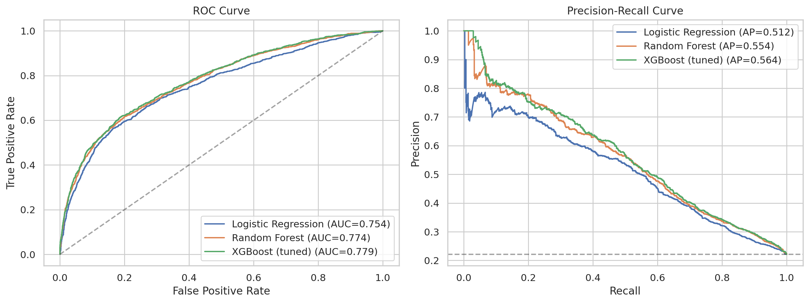
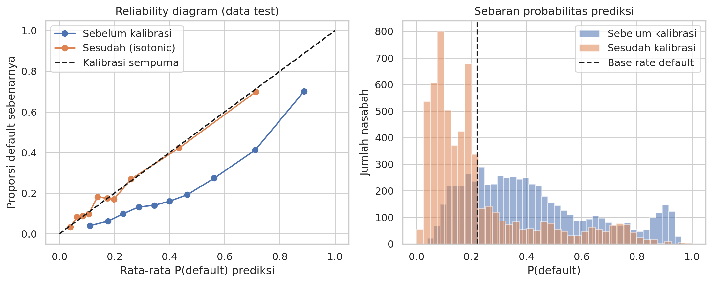
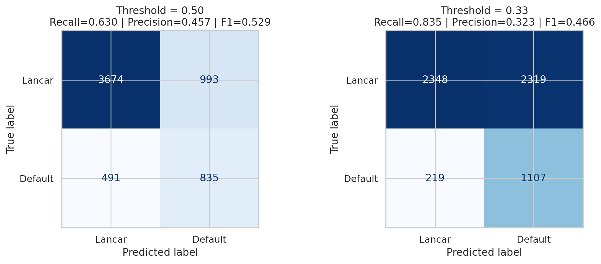
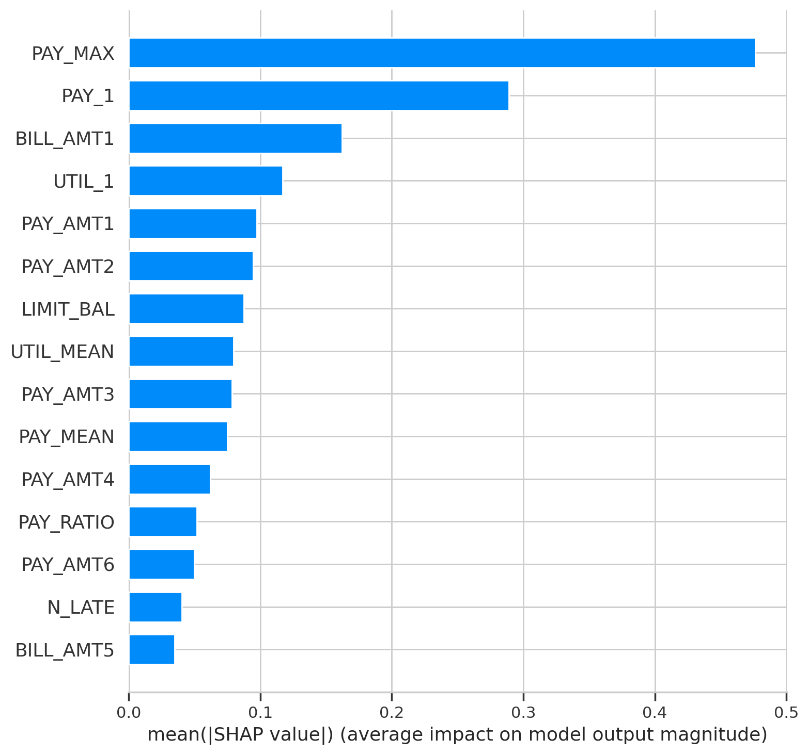

# Credit Scoring: Prediksi Gagal Bayar Nasabah Kartu Kredit

Model *credit scoring* untuk memprediksi apakah seorang nasabah akan **gagal bayar bulan depan**, dibangun dengan tahapan **CRISP-DM** lengkap (Business Understanding sampai Deployment) di Python dan Google Colab. Proyek ini mengerjakan **Pilihan 1** pada UTS Finansial Teknologi (Universitas Siber Indonesia, 2026).

> **Catatan:** ini proyek pembelajaran. Model dilatih pada data Taiwan tahun 2005 dan **tidak boleh dipakai untuk keputusan kredit yang sesungguhnya**.

[](https://colab.research.google.com/drive/1yEet2uLxNLRWSt6ZkxDR4jB3YGPbX6nE?usp=sharing)

## Ringkasan

| | |
|---|---|
| **Tugas** | Klasifikasi biner: `default` = 1 (gagal bayar bulan depan) |
| **Data** | 30.000 nasabah, 23 fitur, 22,12% gagal bayar ([UCI](https://archive.ics.uci.edu/dataset/350/default+of+credit+card+clients)) |
| **Model dibandingkan** | Logistic Regression, Random Forest, XGBoost |
| **Model terbaik** | XGBoost (tuned) + kalibrasi isotonic |
| **Penanganan data tidak seimbang** | Class weighting |
| **Validasi** | Stratified 5-Fold CV (train), hold-out 20% (test) |
| **Interpretasi** | SHAP |
| **Demo** | Antarmuka Gradio ramah pengguna awam |

## Hasil utama

Evaluasi pada 5.993 data uji (threshold 0,5):

| Model | ROC-AUC | PR-AUC | KS | Precision | Recall | F1 |
|---|---|---|---|---|---|---|
| Logistic Regression | 0,7536 | 0,5117 | 0,3990 | 0,4458 | 0,6018 | 0,5122 |
| Random Forest | 0,7739 | 0,5535 | 0,4163 | 0,5565 | 0,5090 | 0,5317 |
| **XGBoost (tuned)** | **0,7789** | **0,5642** | **0,4270** | 0,4568 | 0,6297 | 0,5295 |

Keunggulan XGBoost atas Random Forest tipis (+0,0050 ROC-AUC), sehingga keduanya praktis setara. Keunggulan yang jelas hanya terhadap baseline Logistic Regression.

**Pemilihan threshold.** Karena nasabah gagal bayar yang lolos lebih merugikan daripada nasabah baik yang diperiksa ulang, threshold dipilih dengan memaksimalkan F2-score pada prediksi out-of-fold di data latih:

| | Threshold 0,5 | Threshold 0,332 (skala mentah) |
|---|---|---|
| Recall | 0,630 | 0,835 |
| Precision | 0,457 | 0,323 |
| Default yang lolos (FN) | 491 | 219 |
| Nasabah lancar ditandai berisiko (FP) | 993 | 2.319 |

**Kalibrasi probabilitas.** Class weighting membuat probabilitas mentah terlalu tinggi. Kalibrasi isotonic memperbaikinya:

| Ukuran (data uji) | Sebelum | Sesudah |
|---|---|---|
| Brier score | 0,1792 | 0,1347 |
| Log loss | 0,5411 | 0,4288 |
| ECE | 0,1964 | 0,0143 |
| Rata-rata P(default) | 0,4177 | 0,2208 (proporsi nyata 0,2213) |
| ROC-AUC | 0,7789 | 0,7801 |

Threshold pada skala terkalibrasi menjadi **0,132** dengan Recall 0,8379 dan Precision 0,3282.

**Faktor risiko utama (SHAP):** keterlambatan terparah (`PAY_MAX`), status pembayaran bulan terakhir (`PAY_1`), tagihan terakhir (`BILL_AMT1`), dan rasio pemakaian limit (`UTIL_1`).

## Tahapan CRISP-DM

1. **Business Understanding.** Tujuan bisnis, biaya kesalahan (FN lebih mahal dari FP), dan pemilihan metrik.
2. **Data Understanding.** EDA, distribusi target, korelasi, dan temuan kategori tidak terdokumentasi (`EDUCATION` 0/5/6, `MARRIAGE` 0, nilai -2 dan 0 pada `PAY_`).
3. **Data Preparation.** Hapus 35 duplikat, gabung kategori tak terdefinisi, 6 fitur turunan (`PAY_MEAN`, `PAY_MAX`, `N_LATE`, `UTIL_1`, `UTIL_MEAN`, `PAY_RATIO`), split 80:20 stratified, scaling dan encoding di dalam `Pipeline` untuk mencegah data leakage.
4. **Modeling.** Perbandingan tiga algoritma dengan cross-validation, lalu tuning XGBoost dengan `RandomizedSearchCV`.
5. **Evaluation.** Metrik data uji, kurva ROC/PR, pemilihan threshold, kalibrasi probabilitas, dan SHAP.
6. **Deployment.** Fungsi prediksi dengan validasi input dan antarmuka demo Gradio.

## Cara menjalankan

### Di Google Colab

1. Buka notebook lewat tombol **Open In Colab** di atas.
2. Pilih **Runtime → Run all**.
3. Sel terakhir (6.3) membuka demo Gradio dan mencetak tautan publik sementara.

Seluruh proyek dijalankan di Google Colab. Sel kalibrasi (5.4) memerlukan waktu lebih lama karena melakukan beberapa puluh kali pelatihan ulang.

### Memakai model yang sudah disimpan

```python
import joblib

artifact = joblib.load("models/credit_scoring_model.joblib")
# artifact berisi: model, threshold, feature_names, model_name, calibration, raw_threshold
# butuh pustaka yang sama dengan Colab (scikit-learn, xgboost) agar berkas dapat dimuat
```

Fungsi `predict_applicant()` di notebook (sel 6.1) menerima data mentah satu calon peminjam, memvalidasi input, lalu mengembalikan:

- probabilitas gagal bayar (terkalibrasi),
- skor kredit 300–850 (`300 + (1 − peluang) × 550`),
- kategori risiko (Rendah / Sedang / Tinggi),
- rekomendasi keputusan.

| Kategori | Kondisi peluang gagal bayar (p) | Rekomendasi |
|---|---|---|
| Tinggi | p ≥ threshold (0,132) | Tolak / tinjau manual |
| Sedang | threshold/2 ≤ p < threshold | Setujui dengan limit/bunga disesuaikan |
| Rendah | p < threshold/2 | Setujui |

Batas Tinggi sengaja rendah agar default yang lolos sedikit. Artinya "layak ditinjau ulang", bukan "pasti gagal bayar".

## Struktur repositori

```
.
├── UTS_fintech_run.ipynb              # notebook utama, sudah dijalankan penuh (output tampil)
├── models/
│   └── credit_scoring_model.joblib    # model terkalibrasi + threshold
├── figures/
│   ├── 01_target_distribution.png     # distribusi target
│   ├── 02_default_rate_categorical.png
│   ├── 03_default_rate_pay1.png
│   ├── 04_numeric_distribution.png
│   ├── 05_correlation_heatmap.png
│   ├── 06_roc_pr_curves.png           # kurva ROC dan Precision-Recall
│   ├── 07_confusion_matrix.png        # threshold 0,5 vs threshold terpilih
│   ├── 07b_kalibrasi.png              # reliability diagram
│   ├── 08_shap_summary.png
│   ├── 09_shap_bar.png
│   ├── cv_results.csv                 # hasil cross-validation
│   ├── test_results.csv               # metrik data uji
│   ├── calibration_results.csv        # sebelum vs sesudah kalibrasi
│   └── threshold_calibrated.csv       # threshold pada dua skala probabilitas
├── Paper_Credit_Scoring_UTS_Fintech.docx
└── README.md
```

Kode demo Gradio ada di dalam notebook (sel 6.3), jadi tidak ada berkas terpisah.

## Visualisasi

| Kurva ROC dan Precision-Recall | Reliability diagram (kalibrasi) |
|---|---|
|  |  |

| Confusion matrix | Pengaruh fitur (SHAP) |
|---|---|
|  |  |

## Keterbatasan

- Data berasal dari Taiwan tahun 2005, belum tentu mewakili peminjam di Indonesia.
- Evaluasi, tuning, dan kalibrasi memakai satu kali pembagian data.
- Arti nilai -2 dan 0 pada kolom `PAY_` tidak terdokumentasi di sumber data.
- Belum ada uji kewajaran (*fairness*) antar kelompok `SEX`, `EDUCATION`, dan `MARRIAGE`.
- Biaya bisnis aktual FN dan FP belum dihitung, sehingga threshold akhir perlu disesuaikan.
- Belum ada pemantauan *drift* setelah deployment.

## Sumber dan referensi

- **Dataset:** [Default of Credit Card Clients, UCI Machine Learning Repository](https://archive.ics.uci.edu/dataset/350/default+of+credit+card+clients). Yeh, I. C., & Lien, C. H. (2009). *Expert Systems with Applications, 36*(2), 2473–2480.
- Chapman, P., et al. (2000). *CRISP-DM 1.0: Step-by-step data mining guide*.
- Chen, T., & Guestrin, C. (2016). XGBoost: A scalable tree boosting system. *KDD*, 785–794.
- Lundberg, S. M., & Lee, S.-I. (2017). A unified approach to interpreting model predictions. *NeurIPS 30*.
- Niculescu-Mizil, A., & Caruana, R. (2005). Predicting good probabilities with supervised learning. *ICML*, 625–632.
- Pedregosa, F., et al. (2011). Scikit-learn: Machine learning in Python. *JMLR, 12*, 2825–2830.
- Platt, J. C. (1999). Probabilistic outputs for support vector machines. *Advances in Large Margin Classifiers*, 61–74.
- Zadrozny, B., & Elkan, C. (2002). Transforming classifier scores into accurate multiclass probability estimates. *KDD*, 694–699.

**Pustaka pihak ketiga:** pandas, NumPy, scikit-learn, XGBoost, SHAP, Gradio, matplotlib, seaborn. Penggunaan AI (Claude) untuk bantuan kode dan dokumentasi telah diuji dan dapat dipertanggungjawabkan oleh seluruh anggota kelompok.

## Tim

Kelompok UTS Finansial Teknologi (0060), Sistem dan Teknologi Informasi, kelas 13.5A.23, Universitas Siber Indonesia. Dosen: Rizki Hesananda, S.Kom, M.Kom.

| Nama | NIM | Fokus |
|---|---|---|
| Muhammad Adnan Azwan | 13240018 | Business & Data Understanding |
| Mohammad Panji Satrio | 13240019 | Data Preparation & Modeling |
| Cecilia Putri Winarno | 13240021 | Evaluation (threshold, kalibrasi, SHAP) |
| Rendy Aditya Rahmat | 13240015 | Deployment & dokumentasi |
